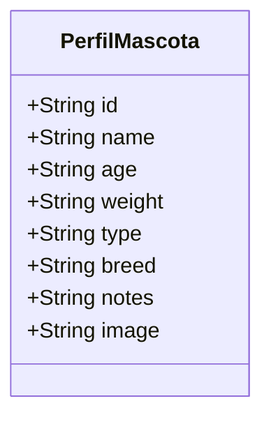
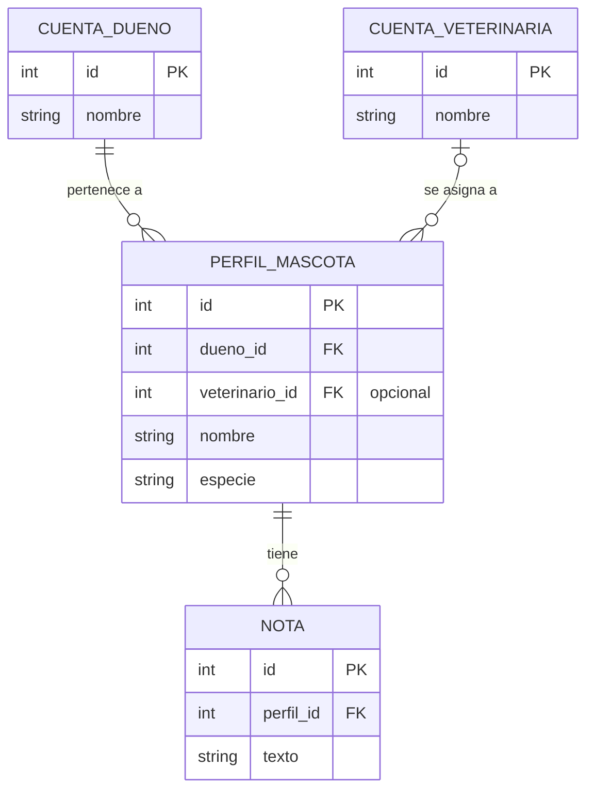

# Análisis de entidad, operaciones CRUD y seguridad

**Sistema:** POWSI Veterinaria
**Fecha de análisis:** 11 de noviembre de 2026

## 1. Descripción breve del sistema

POWSI es una aplicación de una sola página para presentar servicios de una veterinaria, consultar información de contacto, gestionar un perfil local de mascota y preparar una cita. Los formularios se procesan en React y los perfiles y la última cita se guardan en `localStorage` del navegador. La aplicación no tiene conexión con una base de datos ni un backend, y no implementa autenticación ni roles.
Referencias: [README.md](../README.md#L1), [README.md](../README.md#L9), [package.json](../package.json#L1).

## 2. Entidad principal: perfil de mascota

### Justificación

Se selecciona **Perfil de mascota** como entidad principal porque la ruta «Mi mascota» organiza la experiencia de seguimiento y permite seleccionar, añadir, editar y eliminar perfiles. Además, `usePetProfiles` inicializa, actualiza y persiste esos perfiles en `localStorage`. En cambio, la agenda solo guarda una última solicitud provisional y el historial/vacunas que aparecen en el panel son contenido escrito directamente en la interfaz, no registros clínicos gestionables.
Referencias: [App.jsx](../src/App.jsx#L17), [usePetProfiles.js](../src/hooks/usePetProfiles.js#L3), [PetDashboardPage.jsx](../src/pages/PetDashboardPage.jsx#L147), [PetDashboardPage.jsx](../src/pages/PetDashboardPage.jsx#L198).

### Atributos observados

Los tipos indicados como **inferidos** no están definidos en una interfaz o esquema formal. Los campos se almacenan en el navegador; el uso de controles HTML no equivale a validación del lado del servidor.

| Campo | Tipo de dato | Descripción | Obligatorio | Sensible |
|---|---|---|---|---|
| `id` | Cadena; inferido | Identificador local. Se conserva si existe o se genera a partir del índice/tiempo; no es un ID de base de datos. | Sí para identificar el perfil en la interfaz; restricción de modelo no especificada. | No, por sí solo. |
| `name` | Cadena | Nombre de la mascota. El formulario limita la longitud a 40 caracteres. | No especificado en el perfil; no tiene `required`. | No, por sí solo. |
| `age` | Cadena persistida; valor numérico inferido | Edad en años. Se edita con un control `number`, con límites de interfaz 0–40. | No especificado. | No, por sí solo. |
| `weight` | Cadena persistida; valor numérico inferido | Peso en kg. Control `number`, rango 0–200 y paso 0,1 en la interfaz. | No especificado. | No, por sí solo. |
| `type` | Cadena | Tipo o especie, por ejemplo, perro. Longitud máxima de 30 caracteres en el formulario. | No especificado. | No, por sí solo. |
| `breed` | Cadena | Raza. Longitud máxima de 50 caracteres en el formulario. | No especificado. | No, por sí solo. |
| `notes` | Cadena | Notas sobre síntomas o cuidados; máximo de 500 caracteres en el formulario. | No especificado. | **Sí**: puede contener información de salud o cuidados. |
| `image` | Cadena; inferido | Imagen de la mascota. La selección de archivo se convierte en una URL de datos (Data URL) antes de guardarse; también puede estar vacía. | No especificado. | No, por sí sola; valorar privacidad según el contenido. |

El estado y la persistencia tratan edad y peso como cadenas, aunque la interfaz los presenta como números. No se encontró un tipo, esquema o contrato de datos centralizado.
Referencias: [usePetProfiles.js](../src/hooks/usePetProfiles.js#L3), [PetDashboardPage.jsx](../src/pages/PetDashboardPage.jsx#L91), [PetDashboardPage.jsx](../src/pages/PetDashboardPage.jsx#L121).

### Diagrama

Los tipos `String` son tipos inferidos de la estructura JavaScript y del almacenamiento serializado; no representan una definición de esquema persistente.

### Modelo conceptual propuesto (retroalimentación)

El diagrama compartido propone normalizar los datos en cuatro entidades. **Este es un modelo de referencia, no un esquema ya implementado por la aplicación.** El perfil pertenece obligatoriamente a una cuenta de dueño, puede tener cero o una cuenta veterinaria asignada, y puede tener cero o muchas notas independientes.

| Entidad propuesta | Atributos visibles en el diagrama | Relación y cardinalidad |
|---|---|---|
| Cuenta del dueño | `id` (PK), `nombre` | Un dueño tiene `0..N` perfiles; cada perfil pertenece a `1` dueño. |
| Cuenta veterinaria | `id` (PK), `nombre` | Un veterinario puede estar asignado a `0..N` perfiles; cada perfil tiene `0..1` veterinario asignado. |
| Perfil de mascota | `id` (PK), `dueno_id` (FK), `veterinario_id` (FK opcional), `nombre`, `especie` | Pertenece a un dueño y, opcionalmente, a un veterinario; tiene `0..N` notas. |
| Nota | `id` (PK), `perfil_id` (FK), `texto` | Cada nota pertenece a `1` perfil; un perfil tiene `0..N` notas. |

El diagrama no especifica correo, credenciales, fechas, autoría de cada nota, historial de cambios ni permisos por nota; no se deben asumir como campos existentes. Si el producto necesitara atribuir notas a quien las redactó o auditar cambios, serían requisitos de diseño adicionales.

Los tipos `int` y `string` del diagrama son **inferidos para ilustrar el modelo**; la imagen de referencia no especifica tipos de base de datos.

La cardinalidad del veterinario expresa que un perfil puede no tener veterinario o tener uno; un veterinario puede estar asociado con múltiples perfiles. Esta relación por sí sola **no determina qué operaciones** puede hacer sobre las notas cada cuenta: la política de lectura, creación, edición y eliminación debe definirse y hacerse cumplir en el servidor.

## 3. Matriz CRUD y permisos

**Estado de roles:** no hay autenticación, roles ni controles de autorización implementados. Los perfiles y acciones son accesibles desde las rutas de la interfaz. Los roles de la columna «Propuesta» son una distribución futura, no capacidades presentes.

| Entidad o dato | Crear | Leer | Actualizar | Eliminar |
|---|---|---|---|---|
| Perfil de mascota actual | **Interfaz actual:** cualquier visitante del navegador puede añadir. **Propuesta:** dueño autenticado crea perfiles vinculados a su cuenta. | **Interfaz actual:** quien acceda al almacenamiento local. **Propuesta:** dueño del perfil; veterinario solo si está asignado y autorizado por política. | **Interfaz actual:** cualquier visitante con acceso puede guardar cambios. **Propuesta:** dueño modifica datos del perfil; veterinario no altera datos del dueño salvo permiso explícito. | **Interfaz actual:** cualquier visitante con acceso puede eliminar, excepto el último perfil. **Propuesta:** dueño solicita/ejecuta eliminación con validación del servidor; conservar o borrar notas según política de retención. |
| Asignación de veterinario (`veterinario_id`, propuesta) | No existe. **Propuesta:** debe asignarla una cuenta autorizada; el diagrama no especifica cuál. | **Propuesta:** dueño del perfil y veterinario asignado pueden conocer la asignación según necesidad. | No existe. **Propuesta:** solo cuenta autorizada puede asignar o cambiar el veterinario; validar en servidor. | No existe. **Propuesta:** solo cuenta autorizada puede quitar la asignación; revocar de inmediato el acceso derivado de ella. |
| Notas separadas (propuesta: `id`, `perfil_id`, `texto`) | **No existe CRUD de notas independientes. Propuesta:** dueño autenticado puede crear notas de su perfil; veterinario asignado solo si la política lo permite. | **No existe lectura aislada ni autorización. Propuesta:** dueño del perfil; veterinario asignado únicamente con permiso de lectura comprobado en servidor. | **Actualmente `notes` forma parte del perfil local. Propuesta:** dueño puede editar sus notas; veterinario asignado puede editar solo cuando el permiso de edición esté expresamente concedido y auditado. | **No existe borrado por nota. Propuesta:** dueño según política de retención; veterinario no elimina por defecto, salvo permiso específico. |
| Solicitud de cita (`pet`, `service`, `date`, `time`, `notes`) | **Interfaz actual:** cualquier visitante genera una confirmación local. **Propuesta:** el servidor recibe la solicitud y verifica disponibilidad antes de confirmarla. | **Interfaz actual:** confirmación en pantalla y última cita del mismo navegador. **Propuesta:** dueño solicitante y personal veterinario autorizado. | No hay gestión remota de la cita. **Propuesta:** dueño solicita cambios; el sistema valida disponibilidad y permisos en servidor. | No hay cancelación funcional. **Propuesta:** dueño solicita cancelación; el servidor la valida y registra. |
| Historial, vacunas y tratamientos del panel | No implementado. **Propuesta:** personal veterinario autenticado crea registros clínicos asociados al perfil. | **Interfaz actual:** contenido estático visible para cualquiera que abra la página. **Propuesta:** dueño del perfil y veterinario con asignación/permisos vigentes. | No implementado. **Propuesta:** personal autorizado actualiza con trazabilidad. | No implementado. **Propuesta:** política de retención y eliminación restringida. |

La política indicada para notas es una **propuesta inicial de mínimo privilegio**, no está detallada en el diagrama. En particular, el vínculo de asignación de veterinario no debe interpretarse automáticamente como permiso para editar todas las notas.

### Operaciones efectivas y simuladas

- **Perfiles:** crear, leer, actualizar y eliminar funcionan en el estado React y se persisten en el `localStorage` del navegador. La eliminación protege únicamente el caso de la última mascota y muestra una confirmación; ninguno de esos controles identifica a un usuario ni concede autorización de servidor.
  Referencias: [PetDashboardPage.jsx](../src/pages/PetDashboardPage.jsx#L147), [PetDashboardPage.jsx](../src/pages/PetDashboardPage.jsx#L153), [PetDashboardPage.jsx](../src/pages/PetDashboardPage.jsx#L212), [usePetProfiles.js](../src/hooks/usePetProfiles.js#L37).
- **Cita:** el formulario crea un objeto local con mascota, servicio, fecha, hora y notas, muestra una confirmación en pantalla y almacena esa última solicitud en `localStorage`. No registra la solicitud en un servicio remoto, no reserva disponibilidad ni guarda el teléfono dentro de ese objeto. La continuación por WhatsApp es una navegación externa preparada con los datos del formulario.
  Referencias: [AppointmentPage.jsx](../src/pages/AppointmentPage.jsx#L64), [AppointmentPage.jsx](../src/pages/AppointmentPage.jsx#L86), [AppointmentPage.jsx](../src/pages/AppointmentPage.jsx#L95).
- **Información clínica del tablero:** las tarjetas de historial, vacunas y tratamientos son contenido estático del componente; no se identifican operaciones CRUD reales sobre esos datos.
  Referencia: [PetDashboardPage.jsx](../src/pages/PetDashboardPage.jsx#L198).
- **Autorización:** no implementada. El enrutador selecciona páginas por ruta, pero no verifica identidad o permisos. La protección de botones, formularios o rutas del cliente no sería suficiente para proteger recursos en un backend.
  Referencia: [App.jsx](../src/App.jsx#L17).

## 4. Regla de seguridad indispensable

### Regla

**El servidor debe permitir el acceso a un perfil y sus notas únicamente al dueño autenticado vinculado a ese perfil o a un veterinario autenticado asignado a él, y debe verificar el permiso específico de la operación sobre cada nota.**

### Relevancia y estado actual

Las notas pueden describir síntomas, alergias o cuidados. Actualmente forman parte del objeto de perfil guardado como texto serializado en `localStorage`, sin separación ni control de acceso por propietario. El perfil actual tampoco incluye identificador de dueño o veterinario. La ruta «Mi mascota» no exige autenticación y sus acciones CRUD se ejecutan en el navegador.

**Estado:** la regla **no está implementada**. El diagrama compartido propone `dueno_id`, `veterinario_id` opcional y notas asociadas mediante `perfil_id`, pero no se identificó un backend o una base de datos en el proyecto donde hacer cumplir esos vínculos. No se afirma una exposición remota entre usuarios: el riesgo confirmado en la implementación es la ausencia de aislamiento/autorización en el navegador y el acceso local al almacenamiento.
Referencias: [usePetProfiles.js](../src/hooks/usePetProfiles.js#L15), [usePetProfiles.js](../src/hooks/usePetProfiles.js#L37), [App.jsx](../src/App.jsx#L17), [README.md](../README.md#L11).

### Implementación recomendada cuando exista backend

Implementar autenticación y autorización en el servidor. Asociar cada perfil a un `dueno_id` confiable derivado de la identidad autenticada, no de un valor enviado por React; permitir `veterinario_id` nulo y comprobar la asignación vigente para la cuenta veterinaria. Para cada operación de notas, el servidor debe cargar la nota y su perfil, verificar que el usuario sea el dueño o el veterinario asignado y aplicar el permiso concreto de lectura o edición. Definir explícitamente quién puede crear y eliminar notas; no inferir esos permisos solo a partir de la asignación. Aplicar mínimo privilegio, validar referencias foráneas y registrar los cambios clínicos. No confiar en identificadores, filtros, botones o validaciones del cliente. Evitar almacenar notas reales en `localStorage`.

## 5. Duda técnica y respuesta

### Duda

**En el modelo propuesto, ¿cómo debe decidir el servidor si el dueño o el veterinario asignado puede leer, editar, crear o eliminar una nota de una mascota?**

### Respuesta y riesgo fundamentado

En el código actual no existe tal control: `usePetProfiles` obtiene los perfiles directamente de `localStorage`, incluye las notas dentro del objeto y permite actualizarlo por índice; `App.jsx` resuelve la ruta sin comprobar sesión. Cualquier persona que use el mismo perfil del navegador puede llegar a la pantalla y modificar o eliminar esos datos. Un script ejecutado en el mismo origen también podría leer el almacenamiento local. Es un **riesgo potencial de privacidad e integridad en el dispositivo**, no evidencia de acceso remoto a datos de otros clientes.

El diagrama mejora la estructura al vincular perfil y dueño, permitir un veterinario asignado y separar las notas. Sin embargo, la asignación del veterinario no define por sí sola el nivel de acceso a cada nota, y el diagrama no muestra permisos, autoría o historial de cambios. Esa política debe especificarse antes de implementarla. Como criterio inicial, el dueño puede acceder a las notas de sus perfiles; un veterinario solo puede acceder a perfiles con asignación vigente y solo realizar las operaciones expresamente autorizadas por la política del sistema.

Existe además un riesgo potencial ligado al envío externo: la composición del enlace de WhatsApp incluye el teléfono y las notas del formulario en el parámetro `text` de la URL; las notas pueden contener síntomas o alergias. Esos datos salen del contexto local cuando se abre el enlace y quedan sujetos al tratamiento de WhatsApp y al historial/gestión de URL del navegador. El formulario también contiene un teléfono inicial fijo y no indica consentimiento explícito para incluir notas en ese mensaje.
Referencias: [usePetProfiles.js](../src/hooks/usePetProfiles.js#L15), [usePetProfiles.js](../src/hooks/usePetProfiles.js#L51), [AppointmentPage.jsx](../src/pages/AppointmentPage.jsx#L44), [AppointmentPage.jsx](../src/pages/AppointmentPage.jsx#L64), [AppointmentPage.jsx](../src/pages/AppointmentPage.jsx#L71), [AppointmentPage.jsx](../src/pages/AppointmentPage.jsx#L72).

### Recomendación concreta

Antes de habilitar datos reales, implementar el modelo propuesto en un backend y aplicar autorización por dueño y veterinario asignado en cada operación de perfil y nota. Especificar de manera independiente los permisos de crear, consultar, modificar y borrar notas, y auditar los cambios. Para WhatsApp, informar qué datos se transmitirán y pedir consentimiento antes de abrir el enlace; permitir excluir las notas clínicas y no incluir información sensible en la URL por defecto. Hasta entonces, presentar el perfil y la agenda como demostración local, no como expediente clínico ni cita confirmada por la veterinaria.

## 6. Conclusión

La aplicación implementa una experiencia funcional de demostración: los perfiles se gestionan localmente y la agenda produce una confirmación local, mientras que los datos de historial y vacunas son estáticos. El modelo del diagrama —dueño relacionado con perfiles, veterinario opcional y notas separadas— es una mejora conceptual, aún no implementada. Para usar datos reales se requiere persistencia de servidor, autenticación, reglas de autorización por perfil y por operación de nota, y trazabilidad clínica; la confirmación local no acredita una reserva real.
